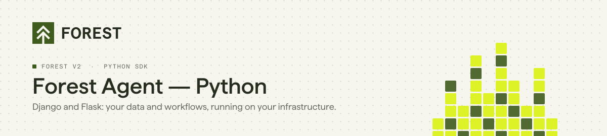
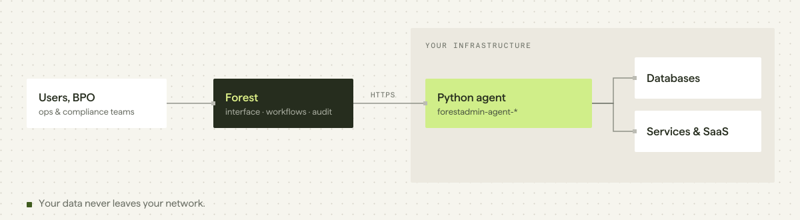

<p align="center">
  <picture>
    <source media="(prefers-color-scheme: dark)" srcset="./assets/header-agent-python-dark.svg">
    
  </picture>
</p>

<p align="center">
  <a href="https://pypi.org/project/forestadmin-agent-django/"></a>
  <a href="https://pypi.org/project/forestadmin-agent-flask/"></a>
  <a href="https://github.com/ForestAdmin/agent-python/actions/workflows/ci.yml"></a>
  <a href="./LICENSE"></a>
</p>

**Forest is the back office for operations teams in regulated companies.** Ops teams review, decide and act on your data from one interface, or let AI agents do it, within the roles, permissions and audit logs you define.

This repository is the **Python agent** for **Django** and **Flask**: the part of Forest that runs inside your application, connects to your databases, and exposes them to the Forest interface. Your business data never goes through Forest.

> [!NOTE]
> **Forest v2.** This is the current Python SDK. Using `django-forestadmin`? You are on v1: see the [migration guide](https://docs.forest.app/guides/migration/from-v1/overview).

## Quick start

### Django

```bash
pip install forestadmin-agent-django
```

The agent plugs in through your settings, not a constructor:

```python
# settings.py
import os

INSTALLED_APPS = [
    # ...
    "forestadmin.django_agent",
]

FOREST_AUTH_SECRET = os.environ.get("FOREST_AUTH_SECRET")
FOREST_ENV_SECRET = os.environ.get("FOREST_ENV_SECRET")
```

```python
# urls.py
from django.urls import include, path

urlpatterns = [
    path("", include("forestadmin.django_agent.urls")),
]
```

Your Django models are exposed automatically. To add computed fields, actions or segments, point `FOREST_CUSTOMIZE_FUNCTION` to a function that receives the agent (e.g. `"myapp.forest_admin.customize_forest"`). The module must exist: if it cannot be imported, the agent does not start.

### Flask + SQLAlchemy

```bash
pip install forestadmin-agent-flask forestadmin-datasource-sqlalchemy flask-sqlalchemy
```

```python
import os

from flask import Flask
from flask_sqlalchemy import SQLAlchemy
from forestadmin.datasource_sqlalchemy.datasource import SqlAlchemyDatasource
from forestadmin.flask_agent.agent import create_agent

db = SQLAlchemy()  # your models are declared on this instance

def create_app():
    app = Flask(__name__)
    app.config["SQLALCHEMY_DATABASE_URI"] = os.environ["DATABASE_URL"]
    # the agent reads its settings from app.config, not from the environment
    app.config["FOREST_ENV_SECRET"] = os.environ["FOREST_ENV_SECRET"]
    app.config["FOREST_AUTH_SECRET"] = os.environ["FOREST_AUTH_SECRET"]

    agent = create_agent(app)
    with app.app_context():
        db.init_app(app)
        agent.add_datasource(SqlAlchemyDatasource(db))
    agent.start()
    return app
```

Full guide: [docs.forest.app/get-started/quickstart](https://docs.forest.app/get-started/quickstart)

## Requirements

| | |
|---|---|
| Python | `>=3.8,<3.14` (CI tests 3.8 to 3.13) |
| Django | `>=3.2,<5.2` |
| Flask | `>=2.0.0` (`async` extra) |
| SQLAlchemy | `>=1.4.0` |

## What the agent gives you

| | |
|---|---|
| **Data** | Your Django models or SQLAlchemy tables, introspected and exposed to Forest. |
| **Customization** | Computed fields, actions, segments and hooks in Python, from your customize function. |
| **Permissions and audit** | Roles, scopes and activity logs defined in Forest, enforced on every request. |

## How it works

<picture>
  <source media="(prefers-color-scheme: dark)" srcset="./assets/arch-agent-python-dark.svg">
  
</picture>

The agent runs **on your infrastructure**. The Forest interface calls your agent, and your agent queries your sources: Forest does not store your business data.

## Documentation

| | |
|---|---|
| Get started | https://docs.forest.app/get-started/quickstart |
| Connect a data source | https://docs.forest.app/get-started/connect/data-sources/overview |
| Migrating from v1 | https://docs.forest.app/guides/migration/from-v1/overview |

<details>
<summary><b>Packages in this monorepo</b></summary>

| PyPI package | Role |
|---|---|
| `forestadmin-agent-django` | Agent for Django |
| `forestadmin-agent-flask` | Agent for Flask |
| `forestadmin-agent-toolkit` | Agent core (transport, auth, permissions) |
| `forestadmin-datasource-toolkit` | Data source contracts, queries, types |
| `forestadmin-datasource-django` | Django ORM data source |
| `forestadmin-datasource-sqlalchemy` | SQLAlchemy data source |

All packages install into the shared `forestadmin.*` namespace. Complete demo applications live in [`src/_example/`](./src/_example).

</details>

## Contributing

Bug reports and pull requests are welcome. See [CONTRIBUTING.md](./CONTRIBUTING.md) for setup, tests and commit conventions.

```bash
./launch_tests_ci_like.sh   # runs the CI locally
```

## License

Apache 2.0. See [LICENSE](./LICENSE).
